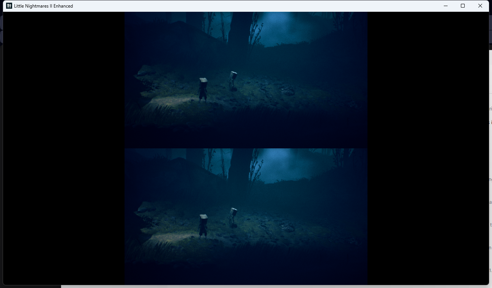
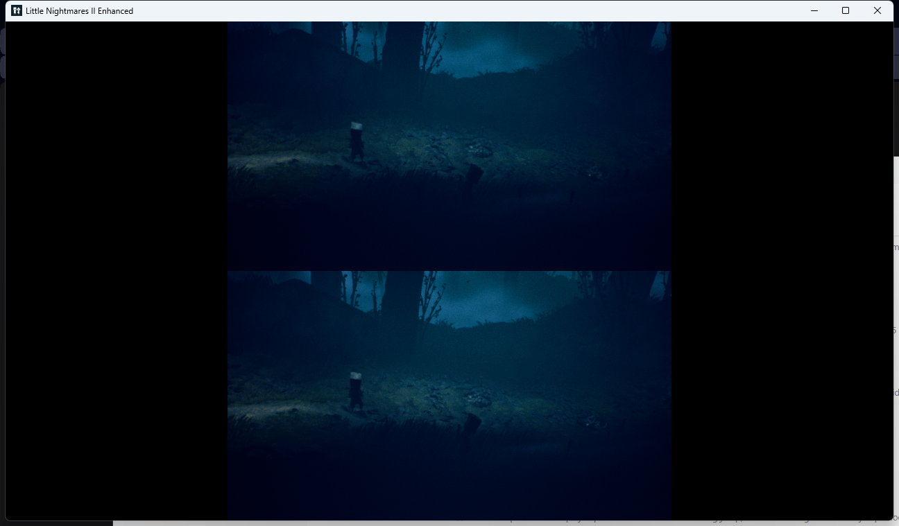
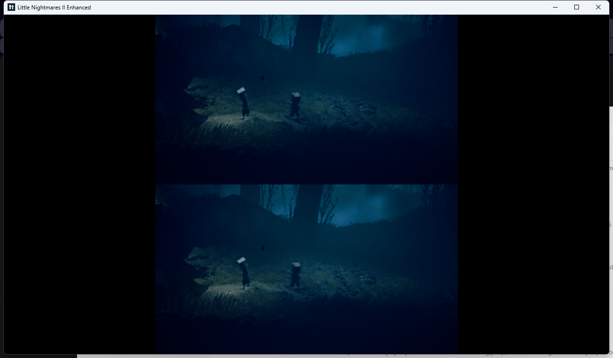
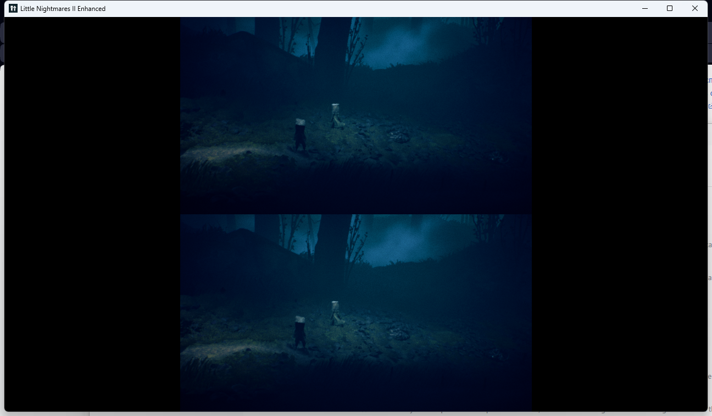

# LN2 COOP

**Кооператив на одном ПК для Little Nightmares II** (Enhanced Edition, GOG) — разделённый экран, два геймпада, второй игрок это **второй Моно**.



`v0.7` · рабочий прототип · UE 4.26 · UE4SS Lua

---

## Кратко: что сделано

- **Split screen на одном ПК.** Второй игрок создаётся штатным `UGameplayStatics::CreatePlayer` — игра сама спавнит ему `BP_PlayerPawnController_C`, такой же `BP_PlayerPawn_C` (Моно) и отдельную камеру. Сеть не нужна, нужны два геймпада.
- **Второй игрок — второй Моно, а не Шестая.** Шестая не тронута: остаётся управляемой игрой AI-спутницей со своим `BP_SixPawn_C` / `BP_PlaypalAIController_C`.
- **Второй Моно управляется вторым геймпадом.** Игра не выполняет свои действия для p2 (ввод доходит до `PlayerInput`, но связанные действия не срабатывают), поэтому мод читает пад 2 сам и ведёт пешку через `CharacterMovement.Velocity`. Работают ходьба (модель поворачивается в сторону движения), бег на X, поворот камеры правым стиком, прыжок на A и подбор предметов на RT.
- **Мод на Lua через UE4SS**, ~1400 строк: при загрузке игрового уровня включает `bUseSplitscreen`, создаёт второго локального игрока (ControllerId 1), ставит его точно в точку p1, читает второй пад и держит пешку на земле. В меню разделение экрана выключается.
- **Найден и обойдён баг UE4SS на этой сборке игры.** UE4SS находил вместо `UObject::ProcessEvent` пустую заглушку `xor eax,eax; ret`, из-за чего *любой* вызов UFunction из Lua молча возвращал ноль (`Add_IntInt(2,3)` → `0`, `CreatePlayer` → `nil`), и второй игрок не создавался в принципе. `UE4SS.dll` пропатчен 21 байтом: обёртка → настоящий `ProcessEvent` игры (RVA `0x2875080`), ASLR-безопасно. Подробности и доказательства: [docs/TECHNICAL.md](docs/TECHNICAL.md).
- **Мод установлен и проверен в реальной игре**: 1 → 2 локальных игрока, `ControllerId = 1`, `PlayerInput = HeliosPlayerInput`, pawn `BP_PlayerPawn_C`, экран разделён, оба Моно видны.

## Что работает (проверено в игре)

| Проверено | Как проверено |
|---|---|
| Создание второго локального игрока | лог мода: `local players 1 -> 2`, `controller id=1 input=HeliosPlayerInput` |
| Второй игрок — Моно, не Шестая | pawn второго игрока `BP_PlayerPawn_C` |
| Разделённый экран, у каждой половины своя камера | скриншот, две независимые камеры |
| Второй Моно ходит со второго пада | в логе значения стика p2 (`test=false`) и сразу за ними `speed=130..176`, позиция пешки меняется; проверено в установленной игре пользователя, скриншот `docs/img/v0.6-user-game-pad.png` |
| Инверсия движения исправлена | обе оси стика переворачиваются в логические; пользователь подтвердил: вверх — вперёд, влево — влево |
| Модель p2 поворачивается в сторону ходьбы | в `anim_dump.txt` `yaw` p2 равен направлению скорости (`vel=163.1,-59.1` → `yaw=-20.0`), и `ForwardSpeed` аним-блюпринта равен `Speed` (178.1/178.1) |
| Спринт на X | в логе `sprint: true`, скорость p2 284–331 против 130–176 при ходьбе; пользователь подтвердил |
| Камера p2 вращается правым стиком | лог `yaw=160 → 192 → 247 → 291`, вид нижней половины меняется |
| Прыжок p2 на A | `jump probe: z=634 → 679 → 634`, `mode=3` в полёте; повторное A в воздухе не складывается |
| Подбор предметов p2 на RT | `pickup: holding BP_Carryable_ShoeBig_C... isP2=true`, `held=true` во время ходьбы; второе RT кладёт предмет (`held=false`), игра жива; **подтверждено пользователем в установленной игре** |
| Второй Моно не проваливается сквозь мир | `player 2 placed on player 1 ... dist 0`, `mode=1`, Z стабилен |
| Старт уровня и переход из меню | `BootupMenu` → `LVL_MainMenu` → `PLVL_Wilderness` |
| Меню не разделяется | `bUseSplitscreen = false` вне `PLVL_*` |
| Перезапуск игры/уровня | второй Моно создаётся заново на upkeep |







## Что ещё не проверено

- Полное прохождение вдвоём: двери, лифты, сюжетные сцены, чекпоинт-респавн с двумя игроками, перенацеливание врагов. Игра во многом рассчитана на одного игрока — где-то второй может остаться за дверью.
- Взаимодействия p2: **подбор предметов работает** (RT, ближайший `PickupComponent` в радиусе 3.5 м), **бросок пока заменён на «положить»** — прямой `TryThrow`/`TryPutdown` у p2 роняет игру. Захват, рычаги, двери и кнопки пока не подключены.
- Столкновения p2 с Шестой и врагами отключены (капсула p2 игнорирует канал Pawn), чтобы два Моно не блокировали друг друга в точке спавна.
- Включение/выключение коопа без перезапуска игры и скрытие второго Моно при выключении.

## Установка

Нужны: лицензионная **Little Nightmares II Enhanced Edition** (GOG или Steam, сборка ниже) и **два геймпада**.

1. Скачать из [Releases](../../releases) архив `ue4ss-patched.zip` и распаковать его в `<игра>\Helios\Binaries\Win64\` — там появятся `dwmapi.dll` и папка `ue4ss\` с уже пропатченным `UE4SS.dll`.
2. Разложить мод:

```powershell
powershell -ExecutionPolicy Bypass -File tools\install.ps1 -GameDir "G:\Little Nightmares 2"
```

Скрипт копирует мод в `ue4ss\Mods\LN2Coop\`, прописывает `LN2Coop : 1` в `Mods\mods.txt`, проверяет хеш `UE4SS.dll` и при необходимости накладывает патч (`tools\patch_ue4ss.ps1`, проверяет SHA-256 и версию игры, делает бэкап `.orig`). Есть `-DryRun`.

Итоговая раскладка:

```
<игра>\Helios\Binaries\Win64\
  dwmapi.dll                 загрузчик UE4SS (proxy)
  Little_Nightmares_II_Enhanced-Win64-Shipping.exe
  ue4ss\
    UE4SS.dll                пропатченный (оригинал — UE4SS.dll.orig)
    UE4SS-settings.ini       настройки под эту сборку
    Mods\
      mods.txt               LN2Coop : 1
      LN2Coop\
        Scripts\main.lua     сам мод
        coop.cfg             on / off
        LN2Coop.log          лог мода
        README.txt
        patch_ue4ss.ps1
```

## Как играть

1. Подключите **оба геймпада до запуска** игры.
2. Запустите игру как обычно (GOG/ярлык/Steam).
3. «Продолжить». Когда загрузится уровень — появится второй Моно и экран разделится (игрок 1 сверху, игрок 2 снизу).

Игрок 2 — второй геймпад (`ControllerId = 1`).

Управление игроком 2: **левый стик** — ходьба, **X** — спринт (удерживать), **правый стик** — камера, **A** — прыжок, **RT** — взять предмет / положить взятый.
Подбор работает; бросок пока заменён на «положить», остальные взаимодействия (захват, двери, рычаги) ещё не подключены.

В момент появления второй Моно стоит точно в точке первого (это проверенная точка на полу);
как только вы двинете левый стик, он отделится и пойдёт сам.

## Выключить кооп

В `ue4ss\Mods\LN2Coop\coop.cfg` написать `off` (или `0`) и перезапустить игру. `on` / `1` — обратно.

## Структура репозитория

```
README.md              эта сводка
CHANGELOG.md           история версий
mod/                   исходники мода (то, что лежит в игре)
  Scripts/main.lua
  coop.cfg, README.txt, mods.txt
tools/
  install.ps1          раскладка мода в установленную игру + проверка патча
  patch_ue4ss.ps1      патч UE4SS.dll (хеши, PE-маппинг, бэкап)
  test_bridge.ps1      автотест моста в G:\LN2\test-install (ходьба/камера/прыжок/подбор)
docs/
  HANDOFF.md           ⬅ для новой сессии: состояние, решения, следующие шаги
  TECHNICAL.md         разбор ProcessEvent, RVA, хеши, настройки UE4SS, мост ввода
  SESSION-LOG.md       хронология работ
  img/split-screen.png
  img/v0.6-p2-moved.png, img/v0.6-camera.png, img/v0.6-p2-and-p1.png, img/v0.6-user-game-pad.png
```

## Новая сессия — начните здесь

Всё, что нужно для продолжения работы (состояние, что проверено, чего не хватает, грабли, адреса, команды), собрано в **[docs/HANDOFF.md](docs/HANDOFF.md)**. Технический разбор — в [docs/TECHNICAL.md](docs/TECHNICAL.md).

## Удаление

Удалите `ue4ss\Mods\LN2Coop` и строку `LN2Coop` из `Mods\mods.txt`. Полностью убрать UE4SS — удалить `dwmapi.dll` и папку `ue4ss\` (вернув `UE4SS.dll.orig` на место `UE4SS.dll`, если он нужен без патча).

## Ограничения и предупреждения

- Патч `UE4SS.dll` **привязан к сборке игры** (SHA-256 exe проверяется скриптом). После обновления игры или UE4SS патч нужно накладывать заново/перепроверять.
- Игра ставится на паузу, когда окно теряет фокус — это поведение самой игры, нажмите «Продолжить».
- Мод меняет только клиентскую сторону; никакой сетевой игры нет.

---

## English (short)

Same-PC split-screen co-op for **Little Nightmares II Enhanced Edition**. Player 2 is a *second Mono*: the game's own game mode spawns a second `BP_PlayerPawn` with its own controller and camera. Six is never touched and stays the AI companion. Two gamepads, no networking.

The bundled `UE4SS.dll` is patched: on this build UE4SS's `ProcessEvent` scan resolves to an empty stub (`xor eax,eax; ret`), so every Lua UFunction call silently returned zero and no second local player could be created. A 21-byte stub redirects UE4SS's wrapper (RVA `0x3ECCC0`) to the game's real `UObject::ProcessEvent` (RVA `0x2875080`), ASLR-safe.

Player 2's input bridge (v0.7): pad 2 values are read from `PlayerInput`, but the game runs none of its bound actions for p2 and `AddMovementInput` has no effect (even with `bForce=true`; `IsMoveInputIgnored()` is false). The bridge therefore writes `CharacterMovement.Velocity` every 33 ms, which gives real collision, slopes, gravity and the walking animation, rotates the camera with `SetControlRotation`, sprints on X (the game maps `ActionSprint` to X), jumps on A by forcing `MOVE_Falling` + vertical velocity, and picks up carryables on RT by calling the item's `PickupComponent:TryPickUp(p2)` after clearing p2's stowed pickup state with `ForceStowOrDrop()`. Throwing is currently replaced by "put down" because `TryThrow`/`TryPutdown` froze the game for player 2. The raw stick axes are inverted on this build, so both movement axes are flipped; player 2 is placed exactly on player 1's known-good floor spot and steps apart by walking.

Tested: second local player creation, split screen with two cameras, level start, menu handling, walking forward/back/strafe from pad 2, sprint on X, camera yaw, jump on A, pickup with RT and put-down in the isolated test copy. Not working yet: throwing, grabbing, doors, levers, lifts, scripted sequences, enemies, checkpoints, p2 collision with Six/enemies.

Read [docs/HANDOFF.md](docs/HANDOFF.md) first when resuming work.
